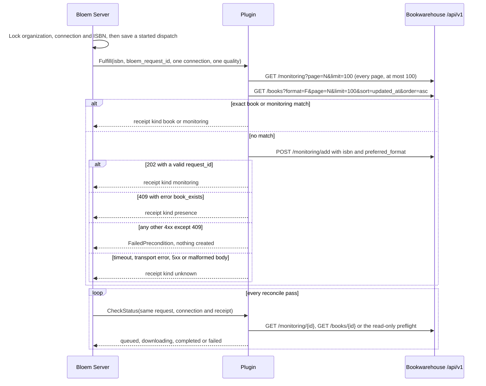

# Plugin behaviour reference

How the Bookwarehouse ebook requests plugin talks to Bloem Server and to
Bookwarehouse. It is a reference for people reading or changing the code. For
installation and settings, see the [README](../README.md).

The plugin implements the `request_router.v1` capability as `bloem.requests.bookwarehouse`
(capability ID `bookwarehouse`), with `metadata.supported_media_types: ["book"]`. It
fulfils ebook requests by ISBN only. It does not fetch audiobooks.

The host (Bloem Server) owns request policy, approval, requester identity, dispatch
leases, connection authority, cancellation, and deciding that a request is fulfilled
once the book appears in the linked ebook library. A provider `completed` status means
"downloaded or already present at Bookwarehouse, awaiting the library scan". It never
proves that the library has the book.

## RPC payload

`RequestDescriptor.media_type` must be `book`, and `seasons` must be empty. Its
`external_ids` must contain:

- `isbn`: canonical, checksum-valid ISBN13 beginning with 978 or 979.
- `bloem_request_id`: the stable host request key, containing only letters,
  digits and hyphens, at most 128 characters.

If the host refiles a request after an earlier submission started, it retains
that submission's stable `bloem_request_id` for recovery and status polling. The
new host request row ID is not a new provider submission identity. Bloem Server
uses the ID of the first request whose submission started for the same
organization, connection and ISBN.

Title and requester display fields are not backend identity. No title search,
ASIN acquisition or arbitrary search-result payload is accepted.

Each call uses one `RouterConnection` with `id`, `base_url`, `api_key` and the
following connection `config` fields. Credentials are supplied per call and are
not persisted by this plugin. The connection `id` follows the same rule as
`bloem_request_id`.

| Field | Default | Behavior |
| --- | --- | --- |
| `allow_http` | `false` | Explicit opt-in for plain HTTP. |
| `allow_pdf` | `false` | Permit PDF as the preferred format. |
| `preferred_format` | `epub` | `epub`, or `pdf` with `allow_pdf: true`. |

`allow_http` and `allow_pdf` must be JSON booleans and `preferred_format` a string.
Bloem Server's ebook setup creates the connection with `preferred_format` set to
`epub` and `allow_http` taken from the form; it has no `allow_pdf` input. Bloem
rechecks that `preferred_format` is `epub`, or `pdf` with `allow_pdf: true`, and
sends exactly one requested quality whose ID is that format.

Qualities may be empty or contain exactly the selected format ID (with `is_4k`
false); returned target quality is that format. `CheckStatus` requires the same
format and connection ID as the target plus the unchanged request identity.
Configuration revisions and backend-origin authority must be fenced by the host.
Bloem Server freezes a secret-free descriptor with a configuration revision (a digest
over the connection's URL, key, plugin configuration, installation, capability
metadata and runtime configuration) when a dispatch starts, and rechecks it before
each call.

The connection URL is an origin and optional plain reverse-proxy path prefix;
the plugin appends `/api/v1`, after trimming trailing slashes. URL userinfo, query
strings (including a bare `?`), fragments, ambiguous path segments (`.` and `..`)
and encoded separators (`%2F`, `%5C`) or backslashes are rejected, as are opaque
URLs, a missing host, an empty or out-of-range port (1 to 65535), control or space
characters, and URLs longer than 4,096 bytes. The scheme must be `https`, or `http`
with `allow_http: true`. The API key must be 1 to 8,192 bytes of printable ASCII
without spaces (0x21 to 0x7E).

Requests use `X-API-Key`, with `Accept: application/json` and, when there is a body,
`Content-Type: application/json`. All redirects, including redirects to the same
origin, are denied: the client returns the 3xx response itself, which counts as a
failure, so the key never reaches the redirect target. Error bodies and transport
errors are never exposed through RPC results or logs. Every response is bounded to
8 MiB, and response headers to 1 MiB. HTTP and full preflight/status operations have
30-second limits: the HTTP client times out each request after 30 seconds, and
`Fulfill`, `CheckStatus` and `TestConnection` each run under a 30-second deadline.
The transport also limits dialling and the TLS handshake to 10 seconds and waiting
for response headers to 20 seconds, uses the proxy from the environment
(`HTTP_PROXY`, `HTTPS_PROXY`, `NO_PROXY`), turns off compression, and closes its idle
connections when the call ends.

Other RPCs:

- `Validate` returns field errors for `connection`, `allow_http`, `allow_pdf`,
  `preferred_format`, `base_url`, `api_key` and `id`, and the form error "Only one
  Bookwarehouse connection is supported." when the host passes any sibling
  connection. Bloem Server validates every create and update through it and passes
  every other connection bound to the same plugin installation, so one installation
  holds one connection.
- `ListConfigOptions` returns the `preferred_format` options: EPUB always, and PDF
  only when the connection's `allow_pdf` is `true`.

## Submission and recovery



Before `POST /api/v1/monitoring/add`, the plugin reads every bounded page of
`GET /api/v1/monitoring?page=N&limit=100`. Monitoring is capped at 100 pages /
10,000 rows; a larger list refuses submission. It also reads
`GET /api/v1/books?format=FORMAT&page=N&limit=100&sort=updated_at&order=asc`: all
pages for catalogs up to 10,000 books, or only the first page for larger catalogs.
For larger catalogs, the add endpoint's exact `409 book_exists` response supplies
book-presence evidence outside that page. Read-only recovery cannot discover a
book outside that page unless a matching monitoring record remains available.

Each monitoring page must carry `requests`, `total`, `page` and `limit`, with `page`
equal to the page asked for, `limit` 100, `total` from 0 to 10,000, and exactly
`min(100, total - (page - 1) * 100)` rows. Each books page must carry `books` and
`pagination` (`page`, `limit`, `total_items`, `total_pages`), with `total_pages`
equal to `total_items / 100` rounded up and the same row-count rule. Every row ID
must follow the `bloem_request_id` character rule and appear only once.

The plugin adopts only exact ISBN and format matches. A row's ISBN matches when its
`isbn13` equals the requested ISBN, or when its `isbn10` is checksum-valid (`X` allowed
as the last character) and converts, with the 978 prefix, to the requested ISBN.
Monitoring rows compare `selected_format`, or `format` when that is empty; book rows
compare `file_format`. Malformed, changing or inconsistent counts, invalid or
duplicate IDs, and multiple exact monitoring matches refuse submission. Book
presence takes precedence over monitoring state: a book match is returned at once as
a `book` receipt with status `completed`, before any monitoring match. A failed
preflight returns `FailedPrecondition` ("Bookwarehouse preflight unavailable; nothing
submitted."), proving this call did not submit anything; an unavailable RPC
transport alone cannot provide that guarantee.

New submissions contain only `{ "isbn": "...", "preferred_format": "epub" }`
or the explicitly permitted PDF equivalent. A 202 response with a valid
`request_id` yields its durable monitoring ID. A 409 with exact
`error: "book_exists"` yields a presence receipt and a library-scan hint. Any other
4xx is a definitive rejection: the plugin returns `FailedPrecondition`
("Bookwarehouse rejected the ebook submission.") without backend text. A timeout
(including the host cancelling the call after the POST started), transport failure,
malformed success body, a 2xx other than 202, a 202 without a valid ID, a 409 without
the exact error, a 3xx or 5xx, or any other ambiguous submission response yields an
unknown receipt instead of recommending another POST.

Bookwarehouse has no atomic ISBN idempotency API. Preflight plus the in-process
mutex cannot prevent races between independent plugin instances. The host must
serialize dispatch by ISBN and durably mark a submission as started before RPC.
After a possible send, it must use only receipt status polling; an automatic retry
must never repeat `Fulfill`. An explicit administrator retry is a separate host
policy decision and must account for the possibility that the first submission
was accepted. HTTP ambiguity cannot prove that a backend job was never created.

Bloem Server meets this by locking on organization, connection and ISBN, reusing the
earliest started dispatch for that ISBN on that connection, and saving the started
dispatch before any RPC. It treats `FailedPrecondition` and `InvalidArgument` from
`Fulfill` as proof that nothing was sent and submits again on a later pass; any other
RPC error is uncertain and recovers only through reads.

The exact receipt encoding is `bwh1.` followed by unpadded base64url of compact
UTF-8 JSON in this field order:

```json
{"kind":"unknown","id":"","isbn":"9780547928227","format":"epub","request_id":"stable-host-request"}
```

Kinds are `monitoring`, `book`, `presence`, and `unknown`. Monitoring/book kinds
carry their backend ID; presence/unknown carry an empty ID. The host can construct
the deterministic unknown receipt above before sending, to recover a crash before
the RPC receipt is saved (Bloem Server does this).
Receipt identity binds the ISBN, format and stable request ID. It carries no
credentials. A receipt longer than 2,048 bytes, with an unknown kind, a format other
than `epub` or `pdf`, or a field that breaks these rules is refused.

`CheckStatus` reads `GET /api/v1/monitoring/{id}` for a monitoring receipt or
`GET /api/v1/books/{id}` for a book receipt and verifies exact identity. Missing
known rows (404) become failed with `external_status: "missing"` and the message
"Backend receipt missing; review required before any retry." A row whose ID, ISBN or
format differs becomes failed with `external_status: "unsupported"`. Expired,
cancelled, failed or unrecognized states never trigger recreation: `CheckStatus`
never posts. Unknown/presence receipts perform the same bounded read-only preflight.
An absent unknown receipt remains queued with `external_status: "unknown"`; an absent
presence receipt stays completed with `external_status: "book_exists"`; existing
evidence reports its safe normalized status. The SDK does not return a replacement
external ID from status polling, so an unknown receipt remains the stored receipt
and resolves by ISBN on later polls.

## Status mapping and cancellation

Bookwarehouse states `pending`, `queued`, `searching`, `searching_now`, `found`,
`monitored`, `retrying` and `not_found` map to queued. `downloading`, `importing`
and `processing` map to downloading; `completed` maps to provider completion.
Unsupported states fail safely. Provider error text, paths and metadata are not
forwarded. Download byte progress is not advertised because the backend only
reports a percentage rather than the SDK's reliable byte totals.

| Raw value | `status` | `message` |
| --- | --- | --- |
| `completed`, or a book receipt | `completed` | Downloaded; awaiting linked library scan. |
| `book_exists` | `completed` | Book already present; awaiting linked library scan. |
| `downloading`, `importing`, `processing` | `downloading` | Bookwarehouse is downloading the ebook. |
| `pending`, `queued`, `searching`, `searching_now`, `found`, `monitored`, `retrying`, `not_found` | `queued` | Bookwarehouse is searching for the ebook. |
| `unknown` | `queued` | Submission outcome unknown; awaiting backend evidence. |
| `failed`, `cancelled`, `canceled`, `expired` | `failed` | Bookwarehouse could not complete this request. |
| `missing` | `failed` | Backend receipt missing; review required before any retry. |
| anything else | `failed` | Bookwarehouse returned an unsupported request state. |

`external_status` passes on only the raw values listed above (and `missing`); any
other value becomes `unsupported`. A new monitoring submission reports raw
`searching`.

Bloem Server reads `external_status: "unknown"` as an uncertain outcome and retries status checks
with backoff; `queued` keeps the request queued, `downloading` shows it as searching,
`completed` moves it to awaiting the library, and `failed` fails it at once. See
[how ebook requests work](https://github.com/Bloem-Studios/bloem-server/blob/main/docs/architecture/bloem-ebook-request-foundation.md#recovery-and-concurrency)
for the backoff and failure limits.

There is no SDK Cancel RPC. Host cancellation is local: stop dispatch and polling
while retaining history. This plugin never calls Bookwarehouse cancellation,
deletes monitoring rows or deletes acquired books.

`TestConnection` authenticates against the monitoring list and validates its shape,
reading `GET /api/v1/monitoring?page=1&limit=100` with the same checks as the
preflight, including the 10,000-row cap. It checks the available read API, not
downstream acquisition permissions or source availability. It returns `ok: true`
with "Bookwarehouse monitoring API authenticated.", or `ok: false` with "Invalid
Bookwarehouse connection configuration." or "Bookwarehouse monitoring
authentication or response check failed." Bloem Server runs it
from the **Test connection** button on a saved connection.

Bloem Server's ebook lane uses only connections whose supported media types contain
`book` (an empty list does not qualify). Its ebook setup writes `book` itself.

## Errors

| RPC | gRPC code | Message |
| --- | --- | --- |
| all | `InvalidArgument` | Missing request. |
| all | `InvalidArgument` | Unknown request capability. |
| `Fulfill`, `CheckStatus` | `InvalidArgument` | Only ISBN ebook requests are supported. |
| `Fulfill`, `CheckStatus` | `InvalidArgument` | A valid canonical ISBN13 and stable Bloem request ID are required. |
| `Fulfill` | `InvalidArgument` | Exactly one Bookwarehouse connection is required. |
| `Fulfill`, `CheckStatus` | `InvalidArgument` | Invalid Bookwarehouse connection configuration. |
| `Fulfill` | `InvalidArgument` | Requested format must match the connection configuration. |
| `Fulfill` | `FailedPrecondition` | Bookwarehouse preflight unavailable; nothing submitted. |
| `Fulfill` | `FailedPrecondition` | Bookwarehouse rejected the ebook submission. |
| `CheckStatus` | `InvalidArgument` | Exactly one Bookwarehouse connection and receipt are required. |
| `CheckStatus` | `InvalidArgument` | Receipt does not match the request and connection. |
| `CheckStatus` | `FailedPrecondition` | Connection format differs from the durable receipt. |
| `CheckStatus` | `Unavailable` | Bookwarehouse status unavailable. |

`Validate` field messages: `connection` "A connection is required."; `allow_http`,
`allow_pdf` "Use a boolean value."; `preferred_format` "Choose EPUB or PDF." or "PDF
requires the connection's Allow PDF setting; otherwise choose EPUB."; `base_url` "Use
an HTTPS origin and optional plain path prefix; HTTP requires explicit opt-in.";
`api_key` "An API key is required." or "Use a valid API key."; `id` "A connection ID
is required."

